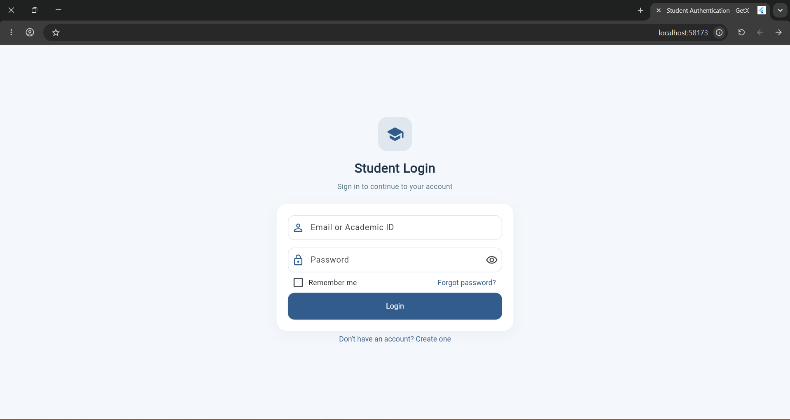
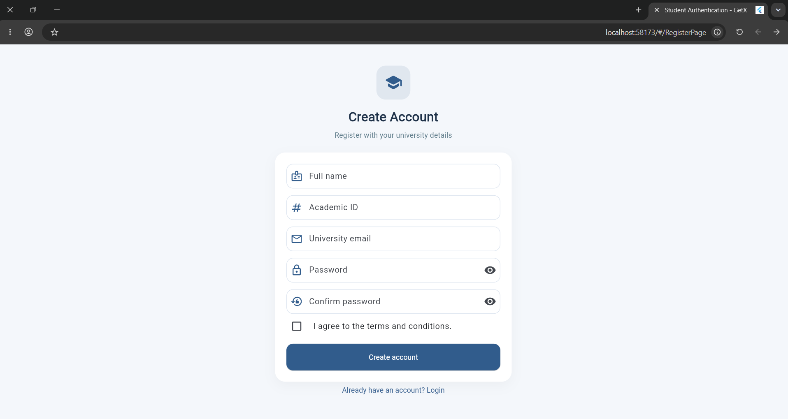
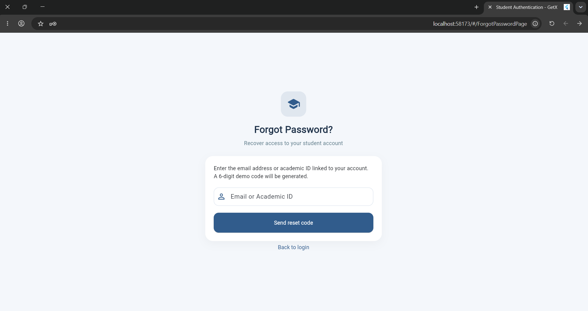
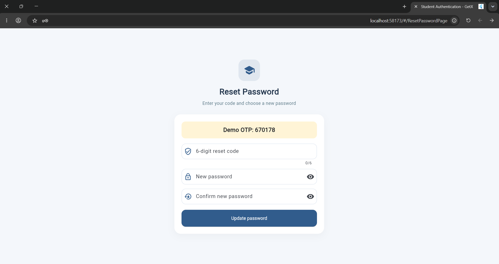
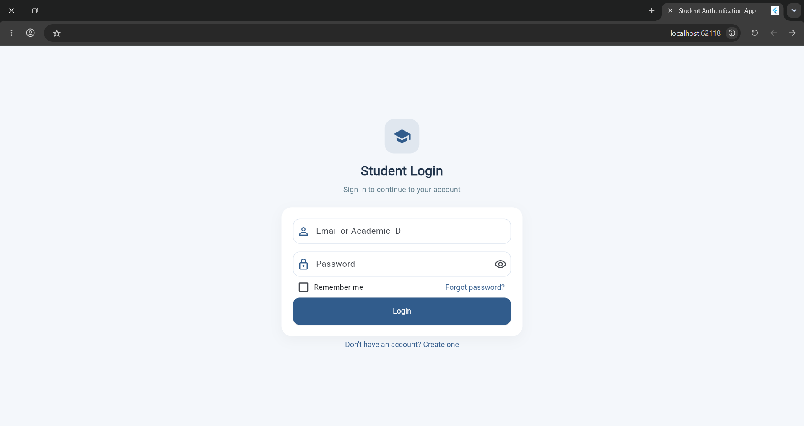
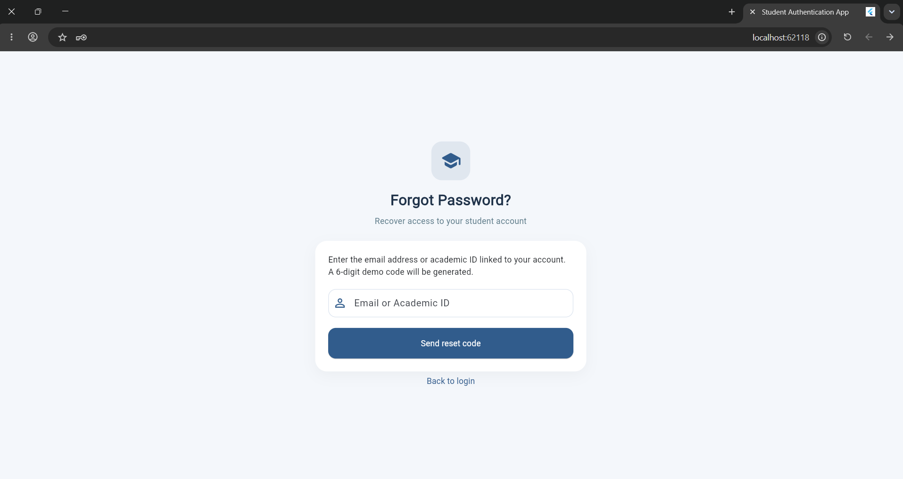
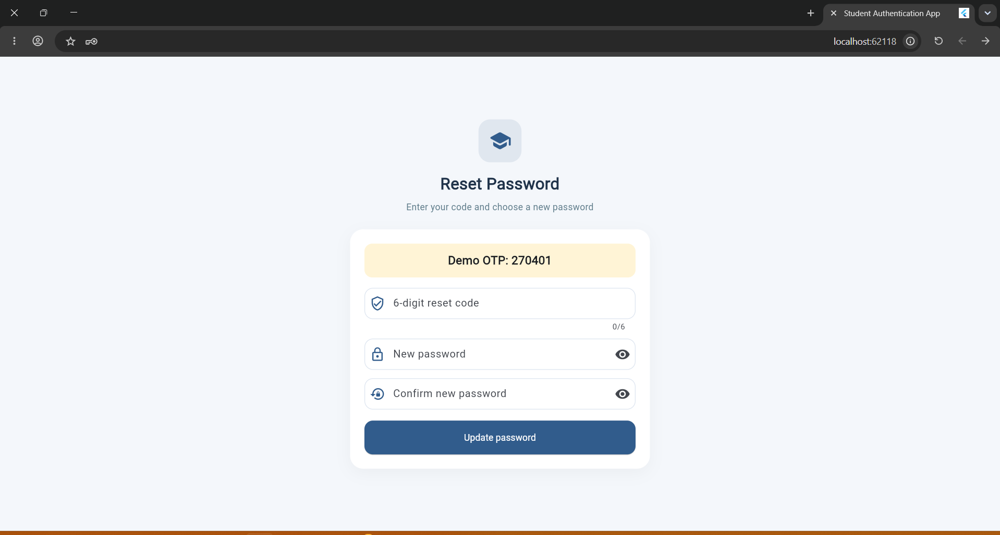

# Student Authentication System – State Management Comparison

## Project Overview

This project implements a **Student Authentication System** using Flutter and Dart. It was developed in two separate versions to demonstrate and compare two popular state management solutions in Flutter:

- **GetX Version**
- **Riverpod Version**

Both versions provide the same user interface, authentication features, form validation rules, and application behavior. The main difference is the state management approach used in each implementation.

The project was developed as an academic assignment to demonstrate practical understanding of Flutter application development, state management, form validation, and software architecture.

## Project Objectives

The main objectives of this project are to:

- Implement a complete student authentication flow using Flutter.
- Apply proper form validation to user input.
- Organize the application using a structured architecture.
- Implement the same application using GetX and Riverpod.
- Compare two state management approaches while maintaining consistent functionality and user experience.

## Application Features

The application consists of four main screens:

| Screen | Description |
|---|---|
| **Login** | Allows students to sign in using their email address or academic ID and password. |
| **Register** | Allows new students to create an account by entering their personal and academic information. |
| **Forgot Password** | Allows students to request a password reset code. |
| **Reset Password** | Allows students to verify the reset code and create a new password. |

### Validation Features

The application includes input validation, such as:

- Required field validation.
- Full name validation.
- Academic ID validation (numeric and length requirements).
- Email format validation.
- Password length and complexity validation.
- Password confirmation matching.
- Six-digit numeric reset code validation.
- Terms and conditions acceptance during registration.

## Technologies Used

- **Flutter** – Cross-platform UI development framework.
- **Dart** – Programming language.
- **GetX** – State management and navigation in the GetX version.
- **Riverpod** – State management in the Riverpod version.
- **Material Design** – Application interface components.

## Repository Structure

```text
state_management_assignment/
│
├── getx_version/
│   ├── lib/
│   ├── test/
│   ├── pubspec.yaml
│   └── README.md
│
├── riverpod_version/
│   ├── lib/
│   ├── test/
│   ├── pubspec.yaml
│   └── README.md
│
├── screenshots/
│   ├── getx/
│   └── riverpod/
│
└── README.md
```

Each implementation is maintained in a separate Flutter project with its own dependencies and documentation.

## Architecture

Both versions follow a layered and organized application structure. The implementation separates responsibilities into:

- **Models:** Represent users, accounts, and authentication requests.
- **Repositories:** Define and implement authentication-related operations.
- **State Management:** Manage application state and authentication operations.
- **Views:** Contain the four application screens and reusable UI components.
- **Utilities:** Contain shared validation and helper logic.

The state management layer differs between the two versions, while the core application behavior remains consistent.

## Getting Started

### Prerequisites

Before running the project, make sure you have the following installed:

- Flutter SDK.
- Dart SDK (included with Flutter).
- Visual Studio Code or Android Studio.
- Git.
- An active emulator, simulator, or connected device.

### 1. Clone the Repository

```bash
git clone https://github.com/YOUR_USERNAME/state_management_assignment.git
```

### 2. Navigate to the Project Directory

```bash
cd state_management_assignment
```

### 3. Run the GetX Version

Navigate to the GetX project directory:

```bash
cd getx_version
```

Install the dependencies:

```bash
flutter pub get
```

Run the application:

```bash
flutter run
```

### 4. Run the Riverpod Version

Return to the repository root:

```bash
cd ..
```

Navigate to the Riverpod project directory:

```bash
cd riverpod_version
```

Install the dependencies:

```bash
flutter pub get
```

Run the application:

```bash
flutter run
```

### 5. Run Static Analysis

To analyze either version, navigate to its project directory and execute:

```bash
flutter analyze
```

> **Note:** GetX and Riverpod are separate Flutter projects. Run each version independently from its own directory.

## Screenshots

The following folders contain screenshots of the application screens in both implementations.

### GetX Version

| Login | Register |
|---|---|
|  |  |

| Forgot Password | Reset Password |
|---|---|
|  |  |

### Riverpod Version

| Login | Register |
|---|---|
|  |  |

| Forgot Password | Reset Password |
|---|---|
|  |  |

> Make sure the screenshot files are added using the exact names and folder structure shown above. Otherwise, update the image paths in this section.

## GetX vs. Riverpod

Both implementations provide the same authentication functionality, but they use different approaches to state management.

| Aspect | GetX | Riverpod |
|---|---|---|
| State Management | GetX Controller | Notifier |
| Reactive Updates | `Obx` | `ref.watch` |
| Accessing Controller Logic | `Get.find` | `ref.read` |
| Dependency Management | GetX dependency injection | Riverpod providers |
| Navigation | GetX navigation | Flutter Navigator |
| Main State Management Component | `GetxController` | `Notifier` |

## Important Implementation Notes

- The authentication system uses an in-memory repository for demonstration purposes.
- No external backend, database, or real email service is connected.
- Registered accounts exist only while the application is running.
- Password reset codes are generated for demonstration purposes and have a limited validity period.
- The generated reset code is displayed within the application as a demonstration mechanism.
- The Remember Me option is included in the login flow, but persistent session storage is not implemented.

This project is intended for educational purposes and is not a production-ready authentication system.

## Academic Purpose

This project demonstrates how the same Flutter application can be implemented using different state management solutions while preserving the same functionality, validation rules, and user experience.

---

**Developed as an academic Flutter assignment.**