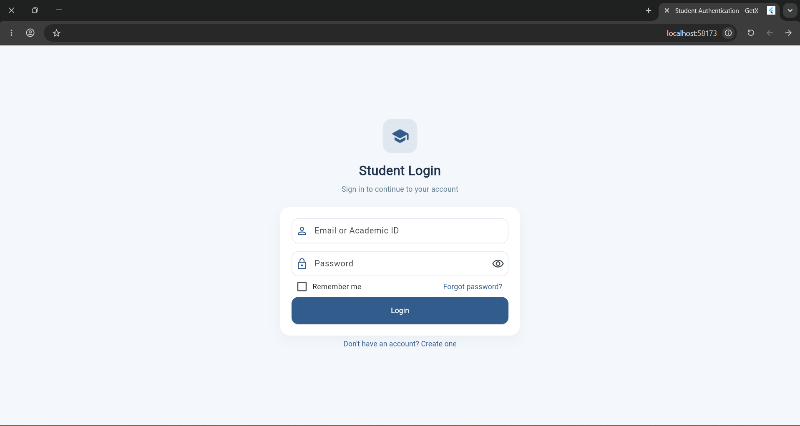
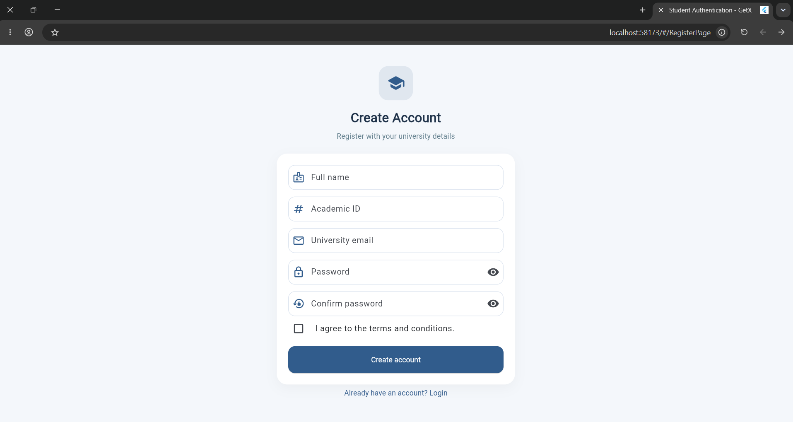
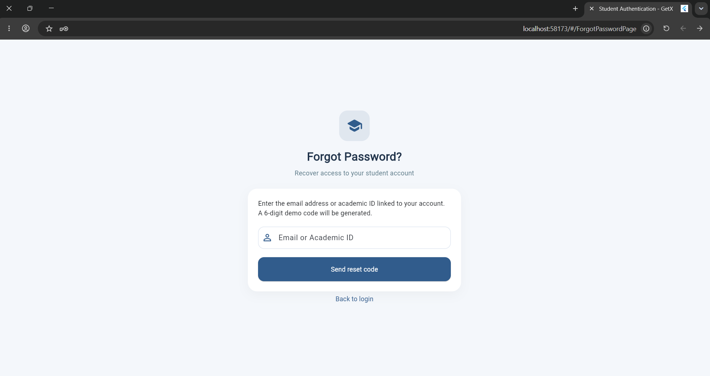
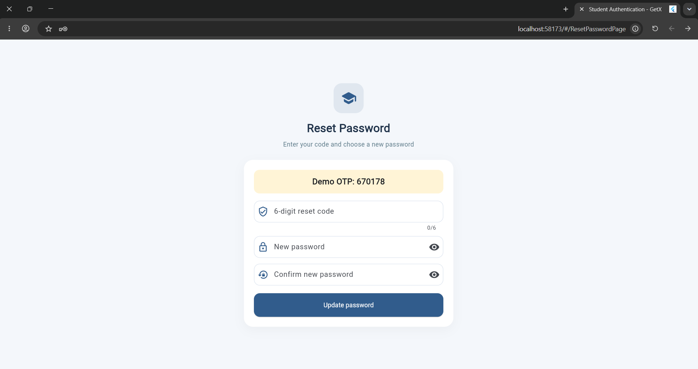

# Student Authentication System – GetX Implementation

## Overview

This directory contains the **GetX implementation** of the Student Authentication System, developed using Flutter and Dart.

The application demonstrates how GetX can be used to manage authentication-related state, handle user interactions, and navigate between screens.

This implementation is functionally equivalent to the Riverpod version included in the parent repository. Both versions share the same application features, validation rules, and general user interface.

## Technologies

- Flutter
- Dart
- GetX

## Features

The application includes four screens:

1. **Login Page**
   - Login using an email address or academic ID.
   - Password input with visibility toggle.
   - Remember Me checkbox.
   - Form validation.
   - Loading indicator during login.
   - Navigation to registration and password recovery.

2. **Register Page**
   - Full name input.
   - Academic ID input.
   - Email input.
   - Password and confirmation fields.
   - Terms and conditions checkbox.
   - Form validation and account registration.

3. **Forgot Password Page**
   - Enter an email address or academic ID.
   - Request a password reset code.
   - Display a success or error message.

4. **Reset Password Page**
   - Enter the six-digit reset code.
   - Create a new password.
   - Confirm the new password.
   - Validate the reset request.

## GetX State Management

GetX is used to manage the application's state and authentication operations.

The main controller is:

```dart
AuthController
```

It extends `GetxController` and manages:

- Loading state.
- Current authenticated user.
- Password reset demonstration code.
- Login operations.
- Registration operations.
- Password reset operations.
- Authentication feedback.

### Reactive State

GetX reactive variables are used to update the interface when application state changes.

For example:

```dart
isLoading = false.obs;
```

The `Obx` widget listens to observable variables and rebuilds the relevant UI when their values change.

Example:

```dart
Obx(() {
  return controller.isLoading.value
      ? const CircularProgressIndicator()
      : const Text('Login');
});
```

### Dependency Management

The controller is accessed using GetX dependency management:

```dart
Get.find<AuthController>();
```

### Navigation

GetX navigation methods are used to move between authentication screens, such as:

```dart
Get.to(() => RegisterPage());
```

```dart
Get.offAll(() => LoginPage());
```

## Project Structure

The main source code is organized as follows:

```text
getx_version/
│
├── lib/
│   ├── controllers/
│   │   └── auth_controller.dart
│   │
│   ├── models/
│   │
│   ├── repositories/
│   │
│   ├── utils/
│   │
│   ├── views/
│   │   └── auth/
│   │       ├── login_page.dart
│   │       ├── register_page.dart
│   │       ├── forgot_password_page.dart
│   │       ├── reset_password_page.dart
│   │       └── widgets.dart
│   │
│   └── main.dart
│
├── test/
├── pubspec.yaml
└── README.md
```

## Architecture

The application uses a layered structure with the Repository Pattern.

- **Models:** Represent the user, account, and authentication request data.
- **Repository:** Defines authentication operations and provides their implementation.
- **Controller:** Coordinates authentication operations and manages reactive application state.
- **Views:** Display the authentication screens and collect user input.
- **Utilities:** Provide validation and reusable helper functions.

This separation helps keep the UI independent from the authentication implementation.

## Validation Rules

The application applies the following validation rules:

| Field | Validation |
|---|---|
| Full Name | Required, at least 3 characters |
| Academic ID | Numeric, 9–10 digits |
| Email | Must follow a valid email format |
| Login Password | Required, at least 6 characters |
| Registration Password | At least 8 characters, including an uppercase letter and a digit |
| Confirm Password | Must match the password |
| Reset Code | Exactly 6 numeric digits |
| Terms | Must be accepted before registration |

## Running the Application

Make sure Flutter is installed and configured.

From this directory, run:

```bash
flutter pub get
flutter run
```

To check the project for issues, run:

```bash
flutter analyze
```

## Screenshots

The following screenshots demonstrate the GetX implementation.

| Login | Register |
|---|---|
|  |  |

| Forgot Password | Reset Password |
|---|---|
|  |  |

## Implementation Notes

- Authentication data is stored in memory for demonstration purposes.
- No real backend or database is connected.
- Password reset codes are randomly generated for demonstration and expire after five minutes.
- The reset code is displayed in the application rather than being sent through a real email service.
- Registered accounts and their data are not permanently stored.
- The Remember Me option is included in the login flow, but persistent session storage is not implemented.

This implementation is intended for academic demonstration and learning purposes, not production authentication.

---

**State Management Approach: GetX**