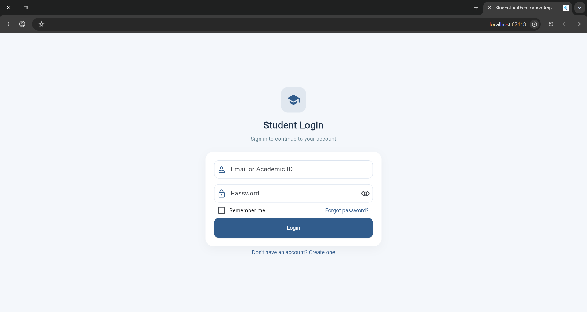
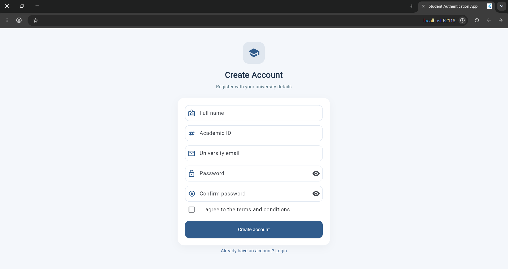
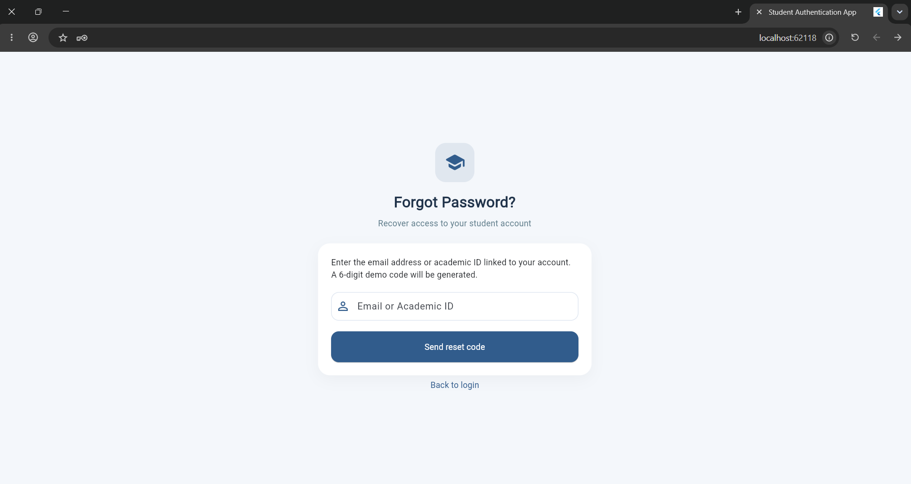
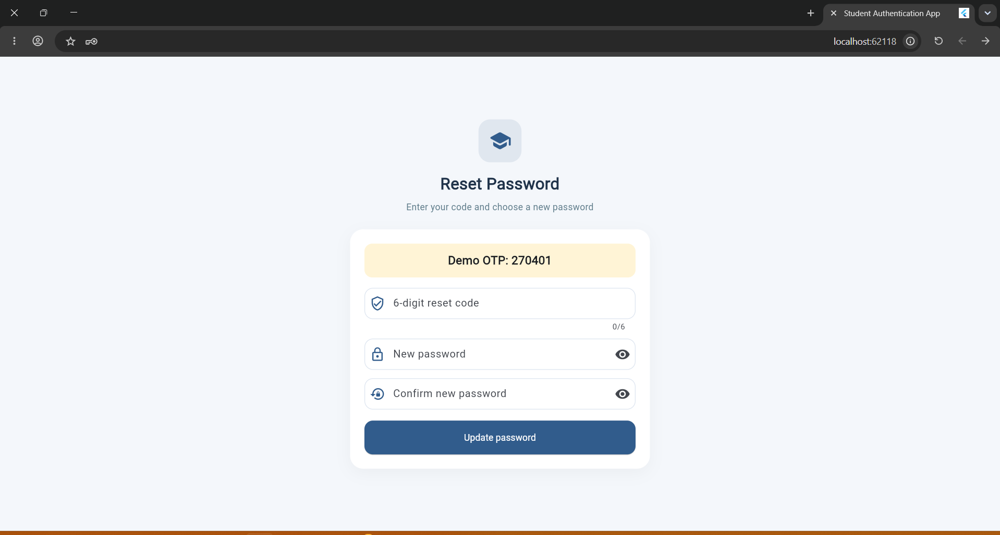

# Student Authentication System – Riverpod Implementation

## Overview

This directory contains the **Riverpod implementation** of the Student Authentication System, developed using Flutter and Dart.

The application uses Riverpod for state management, allowing the UI to observe application state and interact with authentication logic through providers.

This implementation provides the same functionality, validation rules, and general user interface as the GetX version included in the parent repository. The primary difference is the state management solution.

## Technologies

- Flutter
- Dart
- Riverpod
- Flutter Riverpod

## Features

The application includes four authentication screens:

1. **Login Page**
   - Login using an email address or academic ID.
   - Password input with visibility toggle.
   - Remember Me checkbox.
   - Form validation.
   - Loading indicator during login.
   - Navigation to registration and password recovery.

2. **Register Page**
   - Full name input.
   - Academic ID input.
   - Email input.
   - Password and confirmation fields.
   - Terms and conditions checkbox.
   - Form validation and account registration.

3. **Forgot Password Page**
   - Enter an email address or academic ID.
   - Request a password reset code.
   - Display a success or error message.

4. **Reset Password Page**
   - Enter the six-digit reset code.
   - Create a new password.
   - Confirm the new password.
   - Validate the reset request.

## Riverpod State Management

Riverpod is used to manage application state and coordinate authentication operations.

The main state management components are:

- `AuthState`
- `AuthNotifier`
- `NotifierProvider`

### AuthState

`AuthState` represents the current authentication-related state of the application.

It contains information such as:

- Loading status.
- Current user.
- Password reset demonstration code.
- Error messages.

The state is updated using a `copyWith` method, allowing individual state properties to be changed while preserving the others.

### AuthNotifier

`AuthNotifier` extends Riverpod's `Notifier<AuthState>`.

It manages the authentication operations, communicates with the repository, and updates the application state.

The main operations include:

- Login.
- User registration.
- Sending a password reset code.
- Resetting the password.

### Auth Provider

The application exposes its authentication state through a `NotifierProvider`:

```dart
final authProvider =
    NotifierProvider<AuthNotifier, AuthState>(
  AuthNotifier.new,
);
```

This provider makes the authentication state and its notifier available to the UI.

### Watching State with ref.watch

`ref.watch` is used to observe provider state.

When the state changes, the relevant consumer widget rebuilds.

Example:

```dart
final authState = ref.watch(authProvider);
```

### Accessing Operations with ref.read

`ref.read` is used to access the notifier and execute authentication operations without subscribing to state changes.

Example:

```dart
final authNotifier = ref.read(authProvider.notifier);

await authNotifier.login(request);
```

### ProviderScope

The application is wrapped with `ProviderScope` at the root level to make Riverpod providers available throughout the widget tree.

Example:

```dart
void main() {
  runApp(
    const ProviderScope(
      child: StudentAuthRiverpodApp(),
    ),
  );
}
```

## Project Structure

The main source code is organized as follows:

```text
riverpod_version/
│
├── lib/
│   ├── providers/
│   │   └── auth_provider.dart
│   │
│   ├── models/
│   │
│   ├── repositories/
│   │
│   ├── utils/
│   │
│   ├── views/
│   │   └── auth/
│   │       ├── login_page.dart
│   │       ├── register_page.dart
│   │       ├── forgot_password_page.dart
│   │       ├── reset_password_page.dart
│   │       └── widgets.dart
│   │
│   └── main.dart
│
├── test/
├── pubspec.yaml
└── README.md
```

## Architecture

The application follows a layered structure using the Repository Pattern.

- **Models:** Represent users, accounts, and authentication request data.
- **Repository:** Defines authentication operations and provides their implementation.
- **Provider / Notifier:** Manages authentication state and coordinates application operations.
- **Views:** Display the authentication screens and interact with providers.
- **Utilities:** Provide validation and reusable helper functions.

This structure separates UI components from business logic and repository operations.

## Validation Rules

The application applies the following validation rules:

| Field | Validation |
|---|---|
| Full Name | Required, at least 3 characters |
| Academic ID | Numeric, 9–10 digits |
| Email | Must follow a valid email format |
| Login Password | Required, at least 6 characters |
| Registration Password | At least 8 characters, including an uppercase letter and a digit |
| Confirm Password | Must match the password |
| Reset Code | Exactly 6 numeric digits |
| Terms | Must be accepted before registration |

## Running the Application

Make sure Flutter is installed and configured.

From this directory, run:

```bash
flutter pub get
flutter run
```

To check the project for issues, run:

```bash
flutter analyze
```

## Screenshots

The following screenshots demonstrate the Riverpod implementation.

| Login | Register |
|---|---|
|  |  |

| Forgot Password | Reset Password |
|---|---|
|  |  |

## Implementation Notes

- Authentication data is stored in memory for demonstration purposes.
- No real backend or database is connected.
- Password reset codes are randomly generated for demonstration and expire after five minutes.
- The reset code is displayed in the application rather than being sent through a real email service.
- Registered accounts and their data are not permanently stored.
- The Remember Me option is included in the login flow, but persistent session storage is not implemented.

This implementation is intended for academic demonstration and learning purposes, not production authentication.

---

**State Management Approach: Riverpod**